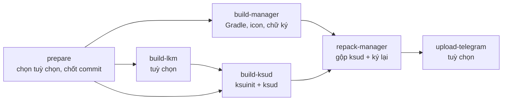

<div align="center">

# 🛠️ BakaSU Manager Builder

**Tự build BakaSU Manager bằng GitHub Actions, dùng key ký, icon, tên app và package của riêng bạn**

[](https://github.com/loyldnguyen/CustomSU/actions/workflows/main.yml)


</div>

---

## ✨ Tính năng

| | |
|---|---|
| 📦 **Repo trống vẫn build được** | Workflow tự clone mã nguồn [Baka-SU/BakaSU](https://github.com/Baka-SU/BakaSU), không cần fork |
| 🔐 **Ký bằng key riêng** | Dùng keystore của bạn, có tuỳ chỉnh signature size và hash |
| ✅ **Không còn cảnh báo đỏ** | Tự thay chữ ký "chính thức" trong code, nên manager không báo *"không phải trình quản lý chính thức"* |
| 🎨 **Icon riêng** | Nhận link ảnh (PNG/JPG/WebP), kể cả link `github.com/.../blob/...` |
| 🏷️ **Đổi tên app và package** | Tuỳ chỉnh `package name` và `label`, áp dụng cho cả manager lẫn ksud |
| ⚡ **Chỉ build phần cần thiết** | Chọn loại build, kiến trúc (ABI), bật hoặc tắt LKM và Telegram để tiết kiệm thời gian |
| 📌 **Build đúng một commit** | Mọi job dùng chung một commit, kể cả khi upstream có commit mới giữa chừng |

---

## 🚀 Bắt đầu nhanh

### 1. Tạo repo và thêm workflow

Tạo một repo mới (để trống cũng được) rồi thêm file:

```
.github/workflows/main.yml
```

### 2. Tạo keystore

> Đã có keystore thì bỏ qua bước này.

```bash
keytool -genkeypair -v \
  -keystore key.jks -storetype JKS \
  -alias mykey \
  -keyalg RSA -keysize 2048 \
  -validity 36500 \
  -dname "CN=MyManager"
```

### 3. Lấy signature size và hash

```bash
keytool -exportcert -alias mykey -keystore key.jks -file cert.der
printf '0x%04x\n' $(stat -c%s cert.der)    # → manager_sign_size
sha256sum cert.der | awk '{print $1}'       # → manager_sign_hash
```

### 4. Thêm Secrets

Vào **Settings → Secrets and variables → Actions → New repository secret**:

| Secret | Giá trị |
|---|---|
| `KEYSTORE` | Nội dung keystore dạng base64: `base64 -w 0 key.jks` |
| `KEY_ALIAS` | Alias của key, ví dụ `mykey` |
| `KEYSTORE_PASSWORD` | Mật khẩu keystore |
| `KEY_PASSWORD` | Mật khẩu key |

### 5. Chạy build

**Actions → Build Manager → Run workflow**, điền các ô cần thiết rồi bấm **Run workflow**.

Khi build xong, tải APK ở mục **Artifacts** → `Manager-release`.

---

## ⚙️ Tuỳ chọn

### Mã nguồn

| Input | Mặc định | Mô tả |
|---|---|---|
| `source_repo` | `Baka-SU/BakaSU` | Repo mã nguồn (`owner/repo`) |
| `source_ref` | `main` | Nhánh, tag hoặc commit SHA |

### Chữ ký

| Input | Mô tả |
|---|---|
| `manager_sign_size` | Kích thước chứng chỉ, dạng hex (`0x02cb`) hoặc thập phân (`715`) |
| `manager_sign_hash` | SHA256 của chứng chỉ (64 ký tự hex) |

> [!IMPORTANT]
> Size và hash phải **khớp với keystore** trong Secrets. Nếu sai, kernel không nhận manager và cảnh báo đỏ vẫn hiện.

### Giao diện

| Input | Mô tả |
|---|---|
| `manager_package_name` | Package name, ví dụ `com.example.manager`. Để trống = mặc định |
| `manager_label_name` | Tên app hiển thị. Để trống = mặc định |
| `manager_icon` | Link ảnh hoặc đường dẫn file trong repo này. Để trống = icon gốc |

> [!TIP]
> Icon đẹp nhất khi là **ảnh vuông, nền trong suốt, từ 512×512 trở lên**. Workflow tự tạo icon cho mọi cỡ màn hình và thu vào vùng an toàn để launcher không cắt mất.

### Phạm vi build

| Input | Lựa chọn | Mô tả |
|---|---|---|
| `build_types` | `release` · `debug` · `release + debug` | Loại APK |
| `abis` | `arm64-v8a` · `arm64-v8a,armeabi-v7a` · `arm64-v8a,x86_64` · `all` | Kiến trúc của ksud và APK |
| `build_lkm` | ✅ / ❌ | Build `kernelsu.ko` (8 KMI). Tắt = nhanh hơn nhiều, nhưng không cài được chế độ LKM |
| `upload_telegram` | ✅ / ❌ | Gửi APK lên Telegram |

---

## 📌 Cố định cấu hình

Khi workflow tự chạy (push), các ô nhập để trống, nên workflow dùng giá trị trong khối `env` ở đầu file. Bạn sửa ở đây để đổi cấu hình mặc định:

```yaml
env:
  DEFAULT_SOURCE_REPO: 'Baka-SU/BakaSU'
  DEFAULT_SOURCE_REF: 'main'
  DEFAULT_SIGN_SIZE: '0x02cb'
  DEFAULT_SIGN_HASH: 'f67905ad...'
  DEFAULT_BUILD_TYPES: 'release'
  DEFAULT_ABIS: 'arm64-v8a'
  DEFAULT_BUILD_LKM: 'false'
  DEFAULT_UPLOAD_TELEGRAM: 'false'
```

Nhớ sửa cả `default:` của từng ô trong `workflow_dispatch.inputs`, để form **Run workflow** hiện đúng giá trị mới.

---

## 🧩 Luồng build



---

## 📲 Telegram (tuỳ chọn)

| Loại | Tên | Mô tả |
|---|---|---|
| Secret | `BOT_TOKEN` | Token bot Telegram |
| Variable | `CHAT_ID` | ID nhóm hoặc kênh |
| Variable | `MESSAGE_THREAD_ID` | ID topic (nếu dùng) |

Nếu chưa đặt `BOT_TOKEN`, workflow bỏ qua bước upload và không báo lỗi.

---

## 🩺 Xử lý lỗi thường gặp

<details>
<summary><b>Manager vẫn hiện cảnh báo "không phải trình quản lý chính thức"</b></summary>

- Kiểm tra `manager_sign_size` và `manager_sign_hash` có khớp keystore không (xem bước 3).
- Trong log job **build-manager**, bước *Set official signature to custom key* phải có dòng `Patched ...`. Nếu thấy cảnh báo *"Official signature string not found"* thì upstream đã đổi code.

</details>

<details>
<summary><b>Lỗi <code>Secret KEYSTORE is not set</code></b></summary>

Secrets không tự chép giữa các repo. Bạn thêm lại đủ 4 secret trong repo đang chạy workflow.

</details>

<details>
<summary><b>Lỗi <code>Ref '...' not found</code></b></summary>

`source_ref` không tồn tại trong `source_repo`. Kiểm tra lại tên nhánh hoặc tag.

</details>

<details>
<summary><b>Không cài đè được lên bản manager cũ</b></summary>

APK mới phải được ký **cùng keystore** với bản đã cài. Nếu đổi key, bạn phải gỡ bản cũ trước.

</details>

---

## 🔒 Bảo mật

- **Không commit** `key.jks`, `cert.der` hay file chứa mật khẩu vào repo.
- Cất keystore ở nơi an toàn. Mất key thì bạn không cập nhật đè được manager đã cài.
- Signature size và hash là thông tin **công khai** (lấy từ chứng chỉ), để trong workflow không sao.

---

## 🙏 Credits

- [Baka-SU/BakaSU](https://github.com/Baka-SU/BakaSU): mã nguồn manager, ksud và kernel module
- [KernelSU](https://github.com/tiann/KernelSU): dự án gốc
- [ylarod/ddk](https://github.com/Ylarod/ddk): container build LKM

<div align="center">

Made with ❤️ for the Android root community

</div>
